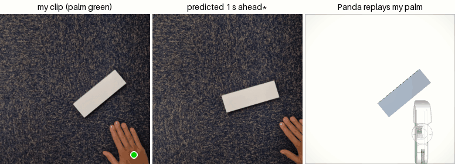
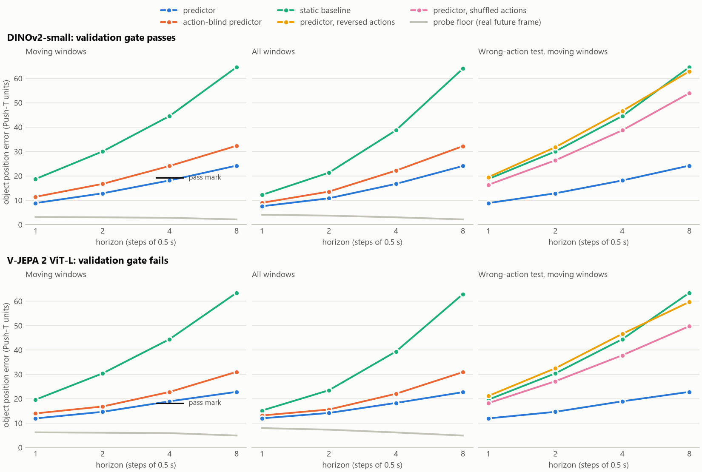
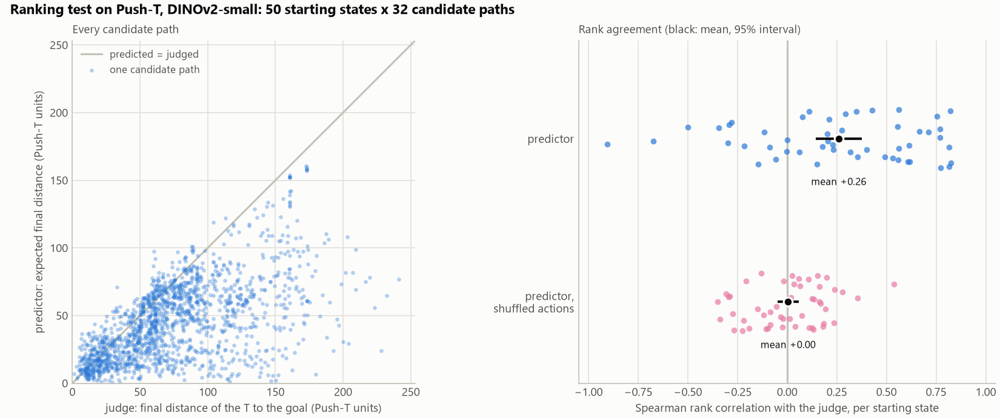
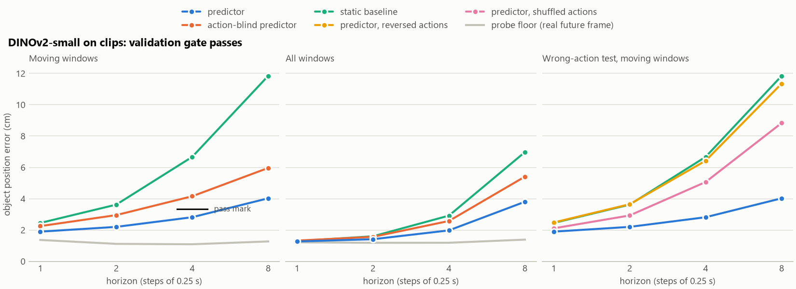
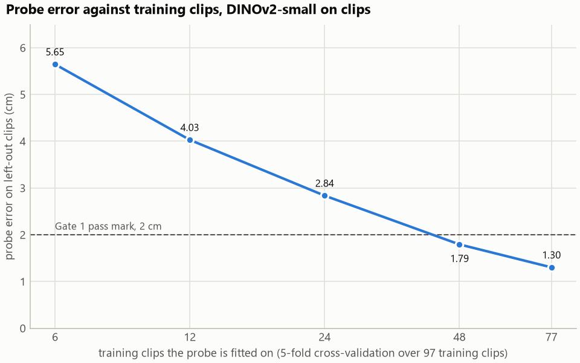
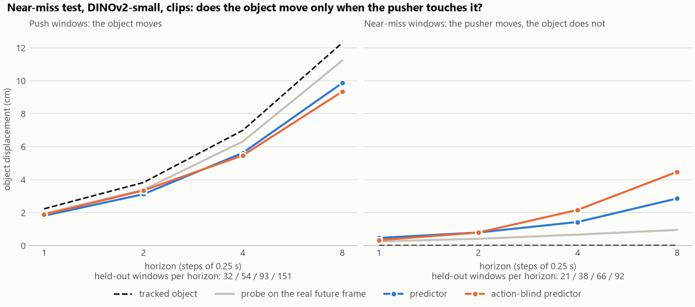
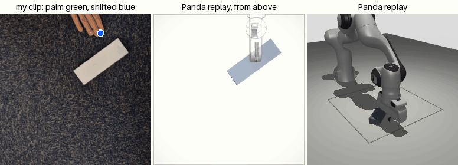

# Pushing world model

I trained a small world model that predicts where a pushed object will go, checked it on Push-T, ran it on phone clips of my own hand pushing a box, and replayed my palm paths on a simulated Franka Panda.

[](https://colab.research.google.com/github/well-iam/humanoid-intern-challenge/blob/main/notebooks/pushing_world_model.ipynb)



Left: one of my held-out clips (palm in green). Middle: what the predictor expected 1 s earlier, from the frames it had then and my real palm moves. A prediction is a feature vector, not an image, so I show the training frame whose features are closest to it. Right: the Panda replaying my palm path in MuJoCo. The clip is not the best one: of the 3 held-out pushes where I know where the palm was at contact, it is the one with the median replay error (4.5 cm; the box also ends 41° off).

## In short

What worked:
- **Push-T** (a public dataset of a round pusher moving a T-shaped block): 2 s ahead, the predictor's error is 25% below the same model trained without the pusher's moves, and 59% below "nothing moves". It passed my fixed pass mark on 1 of 3 training seeds.
- **My own 115 clips:** both pass marks pass. The box's position is read within 1.24 cm, and 1 s ahead the predictor is 32% below the model without the pusher's moves. My first 30 clips failed both; more clips fixed it.
- **The robot:** my palm paths drive a simulated Panda arm. The box ends a median 3.8 to 4.7 cm from where my real box ended (it moved about 15 cm). On all 35 near-misses, the arm passes the box without moving it.

What didn't:
- **Near-misses:** when my hand passes the box, the predictor still moves it 1.44 cm, twice the measurement noise.
- **Choosing a push:** the model ranks 32 candidate pushes roughly like the simulator does, but its single top pick is worse than a random one.
- **The box's angle** in the robot replay: 25° off.

## The idea

- A frozen image encoder (DINOv2-small) turns each frame into a 16 × 16 grid of features.
- A small predictor (6 transformer layers, about 20M parameters) is the only part I train. It takes the last 3 frames' features, where the pusher is, and how it moves next. It outputs the next frame's features. Feeding its output back in gives predictions 1, 2, 4 and 8 steps ahead.
- A linear probe reads the object's position out of real or predicted features. So every score is a distance on the table, not a loss on feature vectors.

Each predictor is compared with two baselines: the **static baseline** (nothing moves) and an **action-blind predictor** (same model and training, but it does not see how the pusher moves). The **wrong-action test** reruns the predictor with reversed or shuffled pusher moves. I score only **moving windows**, where the object really moves within the horizon, because on still windows "nothing moves" wins for free.

I fixed two pass marks before seeing any result:

- **Gate 1:** the probe finds the object on real frames within 4% of the workspace width.
- **Validation gate:** at 4 steps ahead, the predictor's error is at least 20% below the better baseline, and wrong pusher moves make it worse.

## Push-T results

Push-T is a public dataset of a round pusher moving a T-shaped block, with exact positions. I used 100 episodes for training and 50 held out, with a step of 0.5 s. The workspace is 512 units wide.



Error at 4 steps (2 s) ahead, held-out moving windows, in Push-T units:

| | DINOv2-small | V-JEPA 2 ViT-L |
|---|---:|---:|
| probe on real frames (Gate 1: under 20) | 3.96 | 8.27 |
| predictor | **18.14** | **18.96** |
| action-blind predictor | 24.08 | 22.80 |
| static baseline | 44.55 | 44.44 |
| reversed pusher moves | 46.64 | 46.64 |
| shuffled pusher moves | 38.71 | 37.84 |
| validation gate (pass mark) | pass (19.26) | fail (18.24) |

The predictor is 59% below the static baseline. Reversed pusher moves are as bad as predicting no motion at all. So the predictor uses the actions. DINOv2 won and is the only encoder I used after this.

**The DINOv2 pass held on only 1 of 3 seeds.** I retrained both DINOv2 models with seeds 1 and 2 and the same recipe:

| seed | predictor | action-blind | pass mark | gate |
|---|---:|---:|---:|---|
| 0 | 18.14 | 24.08 | 19.26 | pass by 1.12 |
| 1 | 17.95 | 21.31 | 17.05 | fail by 0.90 |
| 2 | 35.19 | 43.46 | 34.77 | fail: training got stuck |

The predictor is stable on the two healthy seeds (18.14 and 17.95). The action-blind predictor, which the gate is measured against, is not. Per-seed plots: [assets/pusht-seeds.png](assets/pusht-seeds.png).

## Ranking test: can the model score paths?

A world model is useful if it can tell good actions from bad ones. For each of 50 held-out starting states, I made 32 candidate pusher paths of 4 s by rotating, scaling and bending the recorded one. The predictor ranked them by how close it expected the T to end up to Push-T's goal. Then Push-T's own simulator played every path and gave the true answer.



- The two rankings agree, weakly. Their rank correlation per start (1 means the same order, 0 unrelated) averages **+0.26 ± 0.06**, and is positive in 36 of 50 starts. With shuffled pusher moves it is **+0.00 ± 0.03**.
- **But the single top pick is worse than a random pick:** it ends 79.8 units from the goal, against 68.3 for a random pick (73.8 on average over all candidates).

Why: the top pick is where the model is most wrong in the hopeful direction. For top picks it predicted 20.7 units from the goal; the simulator said 79.8. Its position error on top picks is 69 units, against 42 on average. Taking the best-scored path selects the model's own mistakes. That is the usual way a planner exploits a learned model. The ranking has signal in bulk, but its best guess is not reliable.

## My data

I recorded 9 takes: my hand pushing a white box (17.8 × 5.8 × 3 cm) on a carpet, filmed from above by a phone 71 cm up. Each clip starts at a clap, so I never touched the phone during a take. The claps cut the takes into 119 clips. I dropped 4 of them, where my hand came back to reset the box. That leaves 115 clips: 80 pushes and 35 near-misses, where my hand passes the box without touching it.

18 clips are held out: 10 pushes and 8 near-misses. 8 of them are the held-out clips of my first 3 takes, fixed before I trained anything. The other 10 are drawn with a fixed seed from the 6 later takes. The other 97 clips train the models.

From video to data:
- A printed ArUco marker gives the table plane. Each frame is straightened to a 50 × 50 cm square, at 8 frames per second.
- MediaPipe finds the hand; the pusher position is the centre of the palm.
- A clip ends when the hand has been out of view for 0.75 s. Otherwise a clip could include my hand coming back to reset the box.
- The box is the bright rectangle of the right size.
- Pixel-to-cm check: the A4 sheet under the marker measures within 0.28 cm of its true size wherever it is seen, and the box's top face within 0.77 cm (5.80 × 17.94 cm on average, ruler 5.8 × 17.8).

Same chain and training recipe as Push-T, with a step of 0.25 s. Nothing was tuned on held-out numbers.

**A first run on 30 clips failed both gates. More data fixed that.** I first trained on my first 3 takes only (22 training clips). Then I recorded 6 more takes and reran the same chain. The 8 held-out clips of the first run are still held out, so I can compare on the same clips.



Error at 4 steps (1 s) ahead on held-out moving windows, cm:

| | first run: 22 training clips, 8 held-out | 97 training clips, same 8 held-out | 97 training clips, all 18 held-out |
|---|---:|---:|---:|
| probe on real frames (Gate 1: under 2 cm) | 3.49 (fail) | 1.72 (pass) | 1.24 (pass) |
| predictor | **3.78** | **3.15** | **2.82** |
| action-blind predictor | 4.46 | 4.61 | 4.16 |
| static baseline | 5.83 | 6.34 | 6.67 |
| reversed pusher moves | 5.29 | 6.45 | 6.43 |
| shuffled pusher moves | 4.42 | 5.10 | 5.06 |
| validation gate (pass mark) | fail (3.57) | pass (3.69) | pass (3.33) |

- **Both gates now pass.** On all 18 held-out clips the predictor is 32% below the action-blind predictor (20% needed) and 58% below the static baseline. It beats the action-blind predictor in all 10 held-out push clips. Resampling those 10 clips puts the ratio at 0.68 (95% interval 0.62 to 0.74).
- Wrong pusher moves hurt more than before. Reversed moves now put the error at the static baseline's level (6.43 vs 6.67 cm). So the predictor leans on the actions more.
- At 8 steps (2 s) ahead, on all 18: predictor 4.02 cm, action-blind 5.96, static 11.84.
- The static baseline got worse with more data on the same 8 clips (5.83 to 6.34 cm). The static baseline is the probe on the current frame. My guess: the first run's weaker probe pulled every position toward the middle, which hid part of the motion.

**Why more clips helped: the probe.** With 22 training clips, the probe read the box's position 3.49 cm off on real frames, and this error sat under every number. Feeding DINOv2 448 px frames instead of 224 px did not help (3.15 vs 3.04 cm). More clips did:



This is 5-fold cross-validation over the 97 training clips (held-out clips never used). The probe crosses the 2 cm mark between 24 and 48 clips. One caveat: the folds mix clips of the same take, so the curve may flatter a bit. The held-out numbers (1.72 and 1.24 cm) agree with it.

**Near-miss test.** When my hand passes the box without touching it, the box should not move.



At 1 s, on the 8 held-out near-miss clips, the predictor moves the box 1.44 cm, while the probe's own jitter on the real frames is 0.67 cm. That is still a fail. But it is better than the first run (2.37 cm), and it now moves the box less than the action-blind predictor (2.17 cm), which the first run never did. So the hand's moves now tell it something about "the hand passed by".

### My palm paths drive the Panda

The palm centre is about 12 cm behind the part of the hand that touches the box. So for each push I measure, at the moment of contact, the vector from the palm to the nearest edge of the box, and move the whole path by it. The Panda's closed gripper follows the moved path 1.5 cm above the table in MuJoCo. The mink library works out the joint angles that put the gripper on each point (inverse kinematics). The simulated box starts where the real one started.



This held-out push is one where MediaPipe found my hand late, so the path is moved by the median shift. It is the one with the median replay error of the 7 such held-out pushes: 5.3 cm.

Final box position, simulation vs my clip, all 115 clips:

| clips | how the path is moved | error, median (worst) | real box moved, median |
|---|---|---:|---:|
| 48 pushes | its own contact shift | 3.8 cm (11.1) | 14.4 cm |
| 32 pushes where the hand was found late | the median shift, turned to the hand's direction | 4.7 cm (19.1) | 16.4 cm |
| 35 near-misses | the median shift | 0.0 cm (0.5); the simulated box never moved | 0.0 cm |

The replay needs no training, so I show all clips. On the first run's 30 clips, the 12 own-shift pushes give the same 3.6 cm as before. Their 10 late pushes improved from 5.5 to 3.0 cm (worst 22.7 to 18.6), because the median shift now comes from 48 pushes instead of 12.

The near-misses stay near-misses on the robot: in [assets/panda-near-miss.gif](assets/panda-near-miss.gif), the first held-out clip of my take of close passes, the gripper goes by the box without moving it. The same replay code runs on Push-T paths: [assets/pusht-panda.gif](assets/pusht-panda.gif).

## Design choices

- **Prediction in feature space, scored in centimetres.** I never decode predictions to pixels. The linear probe turns any prediction into a position, so I can compare models in physical units against simple baselines.
- **Push-T first.** It has exact positions and its own simulator, so I could check the method before recording. My data got a protected slot.
- **Pass marks fixed before results.** The gates, the training recipe and the ranking test setup were all committed before I ran them.
- **The pusher action is the observed move of the pusher, not the controller's command.** That is all hand tracking can give on my clips, so I used the same on Push-T.
- **DINOv2-small over V-JEPA 2 ViT-L.** I picked the winner by the held-out error at 2 s. DINOv2 was also twice as precise for the probe and 2.7 times smaller on disk (3.5 vs 9.2 GB of features).
- **The full 16 × 16 grid, no pooling.** On a 50 cm square, a 4 × 4 pooled cell would cover 12.5 cm, and the 5.8 cm wide box would be a small part of it.

Dropped, and why:

| option | why I dropped it |
|---|---|
| LIBERO | It pins robosuite 1.4.0 and mujoco below 3.9, and one of its dependencies does not build with CMake 4. Plain MuJoCo with the Menagerie Panda and mink installed in a minute. |
| SmolVLA fine-tuning | About 4 to 5 h for 20k steps on an A100, and a free T4 is about 5 times slower. My hand clips also have no robot actions. |
| Planning with the model (CEM) | 4 to 8 h more work, and with a predictor trained on so little data a planner tends to exploit its errors. The ranking test asks the same question for much less, and showed that effect. |
| The released V-JEPA 2-AC predictor | Built for ViT-g, not ViT-L. |
| Predicting the object's angle | Out of time. The probe reads position only. |
| Decoding predictions to pixels | A second model to train. The nearest real frame is enough to show what a prediction means. |

## What didn't work

- **The Push-T gate on more seeds:** passed on 1 of 3. Seed 1 missed by 0.90 units because its action-blind predictor was stronger. Seed 2 got stuck in training (both models close to the static baseline). I did not investigate seed 2 further.
- **V-JEPA 2:** failed the gate (16.8% below its action-blind predictor, 20% needed). Its probe error is twice DINOv2's (8.27 vs 3.96), so part of its error is in the read-out, not the prediction.
- **The ranking test's top pick:** worse than random (79.8 vs 73.8 units from the goal on average).
- **Contact on my clips:** the near-miss test still fails. The predictor moves the box 1.44 cm at 1 s where it stayed still, twice the probe's jitter (0.67 cm). Better than the first run (2.37 cm), not solved.
- **Late hands:** in 32 of 80 pushes MediaPipe found my hand less than 0.25 s before the box moved. Without the palm at contact, the replay has to guess the contact shift (median 4.7 cm error, worst 19.1). All 4 new held-out pushes are in this group, so only 3 held-out pushes have their own shift.
- **The box's angle in replay:** median error 25° on the own-shift pushes. The Panda pushes with two closed fingers, 3.8 × 2 cm. My hand pushes with a wide edge, so the real box turns differently.
- **Box size on the new takes:** the worst top-face error grew from 0.33 cm on the first 3 takes to 0.77 cm on all 9. I did not look into why.
- **Push-T paths replayed on the Panda** (followed blindly, with no correction as they go): median 20 units (about 2 cm at the Panda's scale), worst 281 units. Push-T's 2D physics has no floor friction; MuJoCo does. Once the T drifts, the human's later corrections push it the wrong way.

## How to run

### Colab (no GPU needed)

Runtime > Run all. By default the notebook downloads the cached features, trained predictors and tracks from the Hugging Face dataset [`well-iam/humanoid-intern-challenge`](https://huggingface.co/datasets/well-iam/humanoid-intern-challenge), and rebuilds every figure and GIF on the CPU. It took about 12 min on a fresh Colab runtime (11 min on my machine with the GPU hidden). Set `RETRAIN = "clips"` to retrain the predictors on my clips (about 40 min on a T4, estimated) or `"all"` to also redo Push-T with DINOv2 (about 1.5 h, estimated). Push-T is downloaded from its original URL, never re-hosted.

Tested Colab runtime: Python 3.13.15, PyTorch 2.11.0+cu130, Tesla T4.

### Locally

With [uv](https://docs.astral.sh/uv/), Python 3.12 and an NVIDIA GPU (I used a Quadro RTX 4000, 8 GB):

```bash
uv sync
export PWM_DATA=/path/to/pwm-data   # every stage reads and writes here
uv run pytest                       # fast tests, on a toy world
uv run pytest -m slow               # data, simulator and long-training tests
```

<details>
<summary>Every step, from raw data to the README's figures</summary>

Push-T, end to end (each model trains in about 15 min):

```bash
uv run python scripts/data.py --dataset pusht
for enc in dinov2 vjepa2; do
  uv run python scripts/embed.py --dataset pusht --encoder $enc
  uv run python scripts/train.py --dataset pusht --encoder $enc --precision fp16 --batch-size 16 --steps 2500 --lr 1e-3
  uv run python scripts/train.py --dataset pusht --encoder $enc --precision fp16 --batch-size 16 --steps 2500 --lr 1e-3 --blind
  uv run python scripts/evaluate.py --dataset pusht --encoder $enc
done
uv run python scripts/compare.py --dataset pusht              # error-vs-horizon.png, winner.json
uv run python scripts/rank.py --dataset pusht --encoder dinov2
uv run python scripts/panda_replay.py --dataset pusht
```

The extra seeds: the two `train.py` lines and `evaluate.py` with `--encoder dinov2 --seed 1` (and 2), then `uv run python scripts/seeds.py --dataset pusht --encoder dinov2 --seeds 0 1 2`.

My clips: put the takes in `$PWM_DATA/clips/raw/`, then

```bash
uv run python scripts/track.py
uv run python scripts/embed.py --dataset clips --encoder dinov2
uv run python scripts/train.py --dataset clips --encoder dinov2 --precision fp16 --batch-size 16 --steps 2500 --lr 1e-3
uv run python scripts/train.py --dataset clips --encoder dinov2 --precision fp16 --batch-size 16 --steps 2500 --lr 1e-3 --blind
uv run python scripts/evaluate.py --dataset clips --encoder dinov2
uv run python scripts/near_miss.py --dataset clips --encoder dinov2
uv run python scripts/probe_scaling.py --dataset clips --encoder dinov2
# the same model scored on the first 3 takes' 8 held-out clips only (the before/after table)
uv run python scripts/evaluate.py --dataset clips --encoder dinov2 --only-takes VID_20261016_141304 VID_20261016_141455 VID_20261016_141631
uv run python scripts/near_miss.py --dataset clips --encoder dinov2 --only-takes VID_20261016_141304 VID_20261016_141455 VID_20261016_141631
uv run python scripts/panda_replay.py --dataset clips --episode VID_20261016_163841-02 VID_20261016_165020-05
uv run python scripts/gif_strip.py --episode VID_20261016_141304-11
uv run python scripts/readme_assets.py   # copies the README's figures into assets/
```

</details>

The 1080p takes are not public. To run the clip chain without them, download the Hugging Face dataset into `$PWM_DATA` (9.6 GB; add `--exclude "clips/videos/*"` to skip the 0.6 GB of 720p takes): it holds the tracked episodes, so you can skip `track.py` and start from `embed.py`.

```bash
uv run hf download well-iam/humanoid-intern-challenge --repo-type dataset --local-dir $PWM_DATA
```

## License

Code: MIT (see `LICENSE`). My clips and the cached results on Hugging Face: CC BY 4.0.
